<div align="center">


# VitalUp

**One calm place for your daily health: activity, nutrition, water, sleep, mood and weight, with an AI coach and a friendly Arena.**

[](https://flutter.dev)
[](https://dart.dev)
[](https://supabase.com)
[](https://play.google.com/store/apps/details?id=com.vitalup.app)
[](https://vitalup.live)

[Screenshots](#screenshots) · [Features](#features) · [Architecture](#architecture) · [Tech stack](#tech-stack) · [Getting started](#getting-started) · [Testing](#testing)

</div>

---

## Overview

VitalUp is a Flutter health app built offline first. Everything you log is
saved on the device straight away and synced to Supabase when a connection is
available, so the app works the same on a plane, on a trail or in a basement
gym.

- **Track:** GPS and timed workouts, meals (AI photo scanner, barcode, search),
  water, sleep, mood and stress, weight and screen time.
- **Understand:** trend charts for every tracker, weekly summaries, a
  clinician-friendly health report and an AI coach, Vita, that reads your own
  numbers.
- **Stay motivated:** points, levels, streaks with rest days, 32 badges,
  friends, challenges and community leaderboards, all kept in the Arena so
  Home stays focused on health.

Android is the primary platform (home screen widgets, Health Connect, push and
Crashlytics). The iOS project builds in CI; widgets, push and Crashlytics are
not set up there yet.

## Screenshots

All screenshots use demo data for the account **Tarun Talan** (`@tarun_talan`).
They are rendered from the app's own widgets by the test suite (see
[Regenerating screenshots](#regenerating-screenshots)).

### Home

<table>
  <tr>
    <td align="center">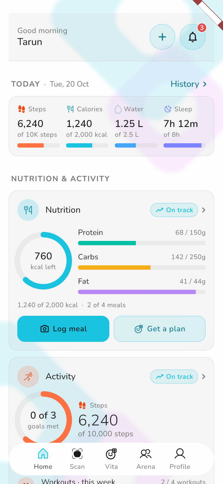</td>
    <td align="center">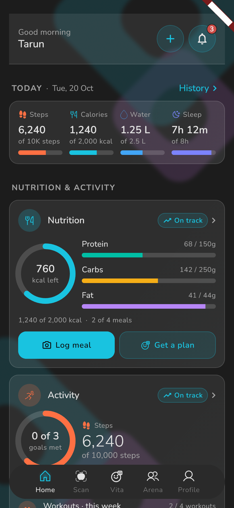</td>
    <td align="center">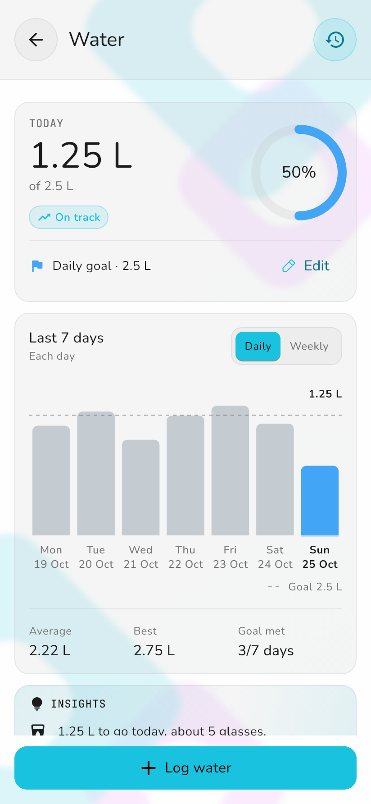</td>
  </tr>
  <tr>
    <td align="center"><sub><b>Today</b><br/>Steps, calories, water and sleep at a glance</sub></td>
    <td align="center"><sub><b>Dark theme</b><br/>Every screen follows the system theme</sub></td>
    <td align="center"><sub><b>Tracker detail</b><br/>Goal, 7 and 30 day trends, insights, history</sub></td>
  </tr>
</table>

### Logging

<table>
  <tr>
    <td align="center">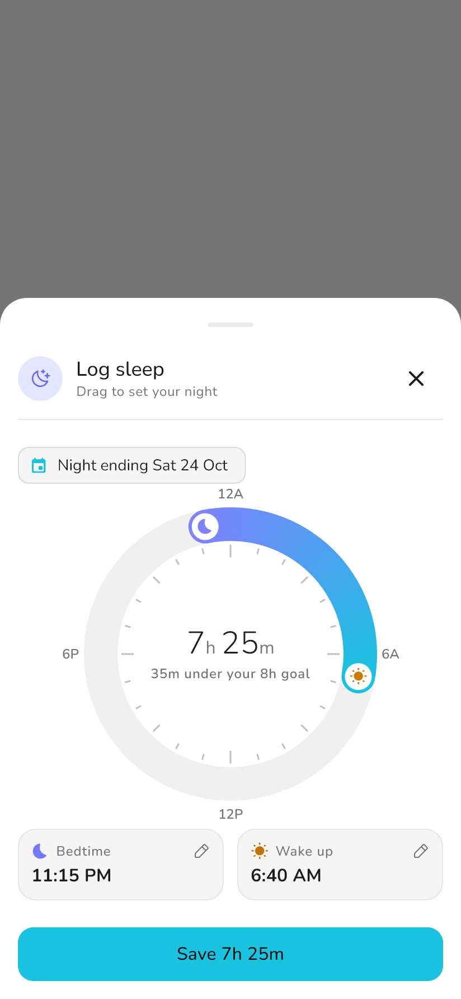</td>
    <td align="center">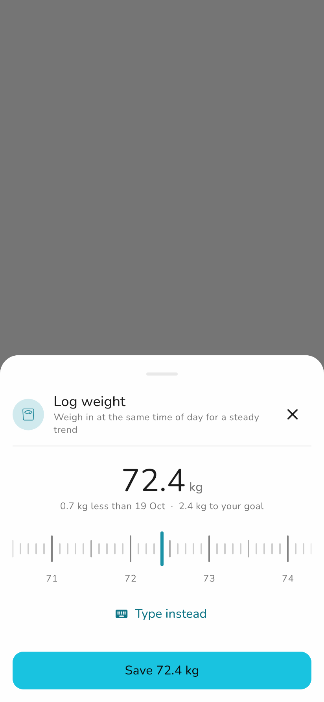</td>
    <td align="center">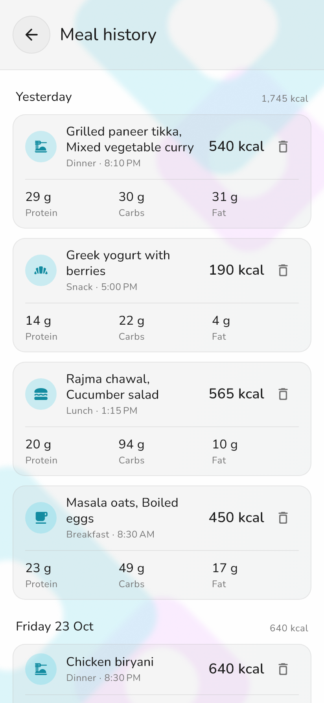</td>
  </tr>
  <tr>
    <td align="center"><sub><b>Sleep</b><br/>Drag bedtime and wake-up on a 24-hour dial</sub></td>
    <td align="center"><sub><b>Weight</b><br/>Ruler with haptic ticks and goal progress</sub></td>
    <td align="center"><sub><b>Meal history</b><br/>Scanned meals with calories and macros per day</sub></td>
  </tr>
</table>

### Vita, the AI coach

<table>
  <tr>
    <td align="center">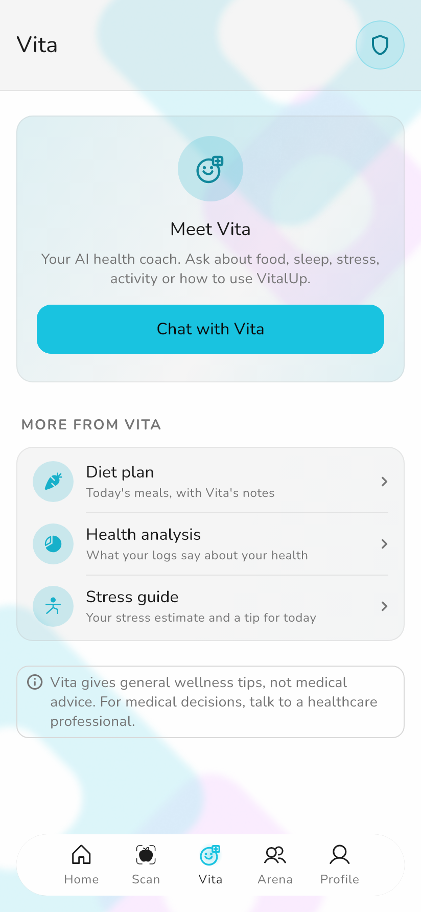</td>
    <td align="center">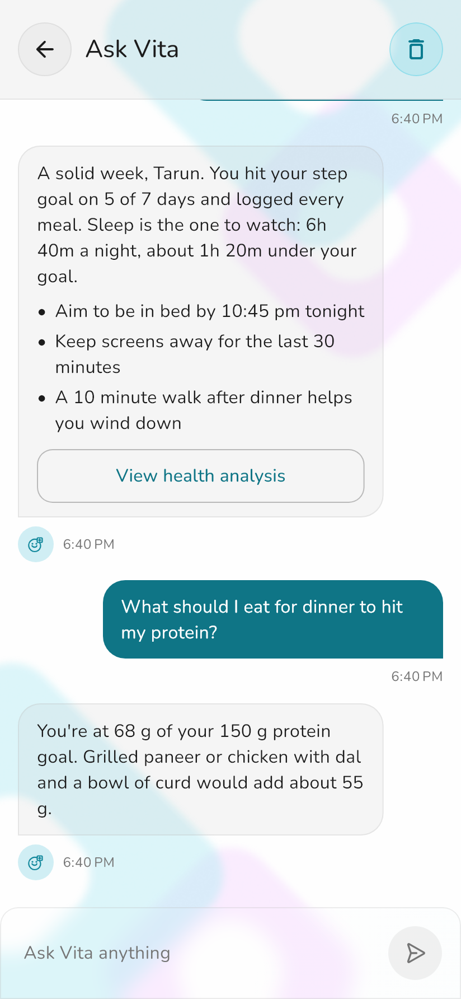</td>
    <td align="center">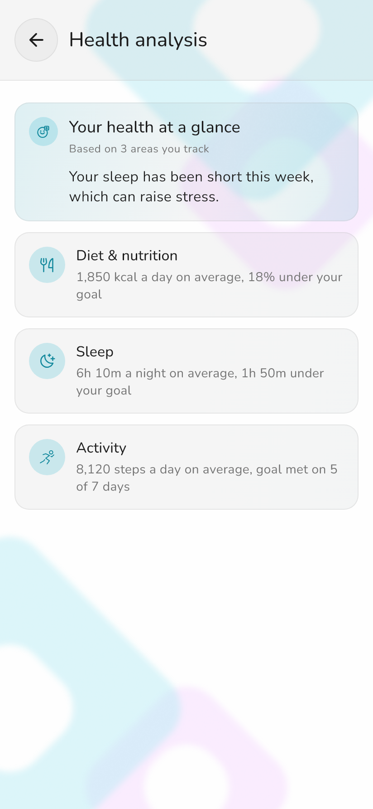</td>
    <td align="center">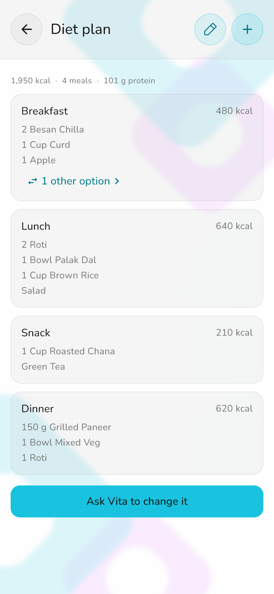</td>
  </tr>
  <tr>
    <td align="center"><sub><b>Vita</b><br/>Chat, diet plan, analysis, stress guide</sub></td>
    <td align="center"><sub><b>Chat</b><br/>Answers grounded in your own logs</sub></td>
    <td align="center"><sub><b>Health analysis</b><br/>Diet, sleep and activity in plain words</sub></td>
    <td align="center"><sub><b>Diet plan</b><br/>AI meal plan with swappable dishes</sub></td>
  </tr>
</table>

### Arena

<table>
  <tr>
    <td align="center">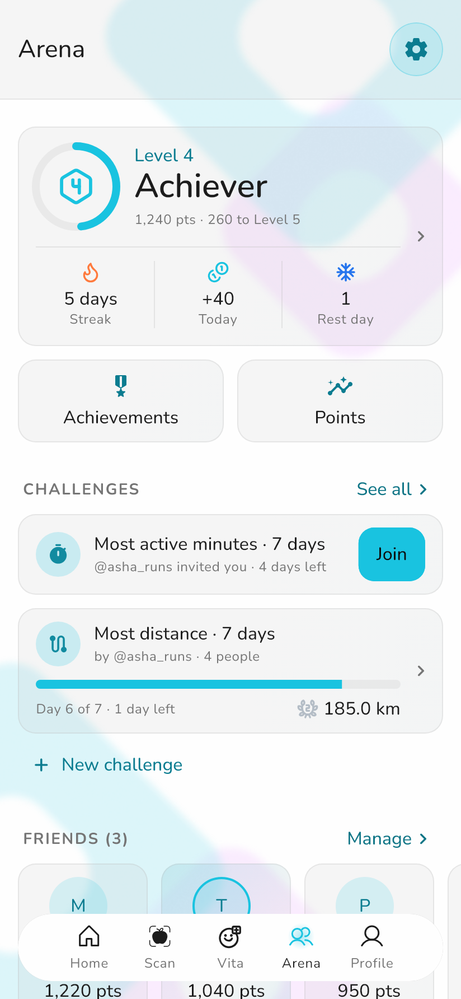</td>
    <td align="center">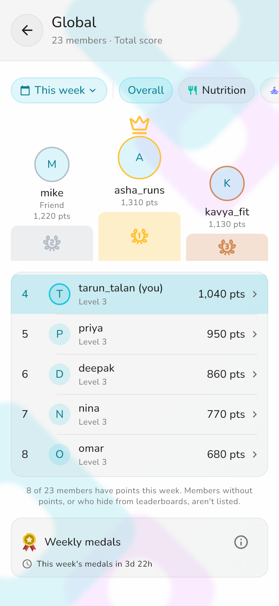</td>
    <td align="center">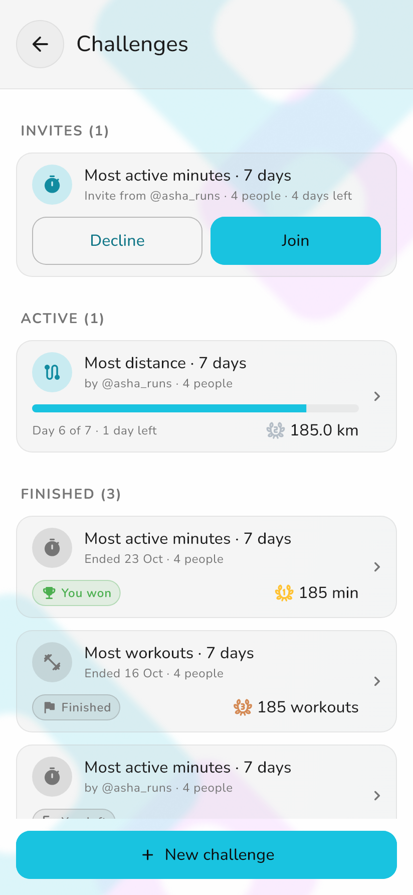</td>
    <td align="center">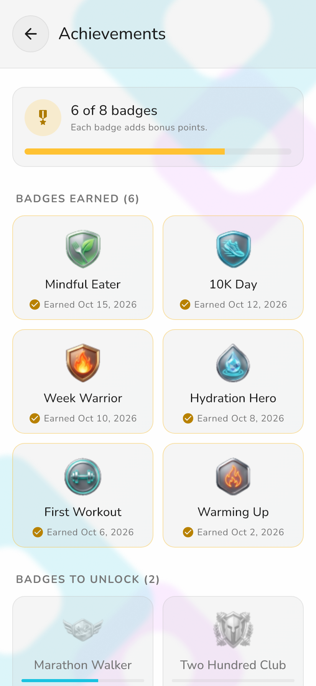</td>
  </tr>
  <tr>
    <td align="center"><sub><b>Arena</b><br/>Level, streak, challenges and friends</sub></td>
    <td align="center"><sub><b>Leaderboards</b><br/>Global, city and interest communities</sub></td>
    <td align="center"><sub><b>Challenges</b><br/>1 to 14 day challenges with friends</sub></td>
    <td align="center"><sub><b>Achievements</b><br/>32 badges and community awards</sub></td>
  </tr>
</table>

### Onboarding and Pro

<table>
  <tr>
    <td align="center">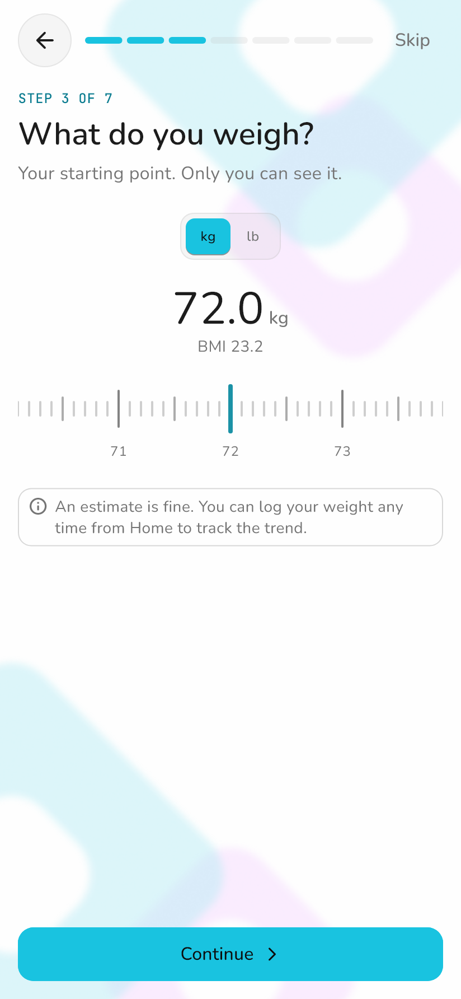</td>
    <td align="center">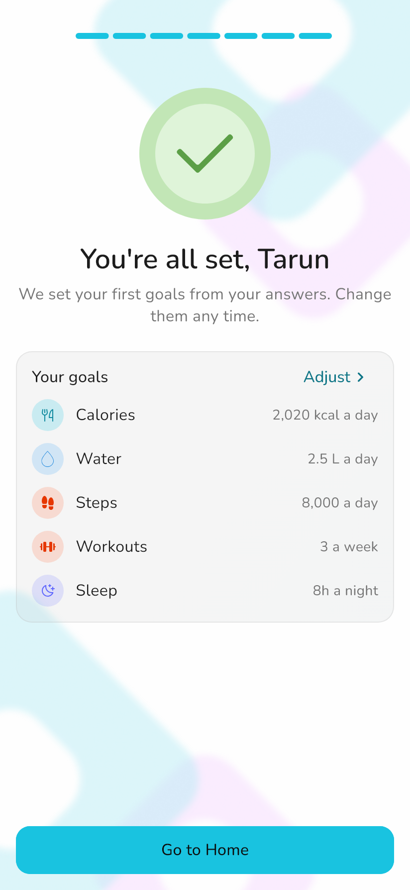</td>
    <td align="center">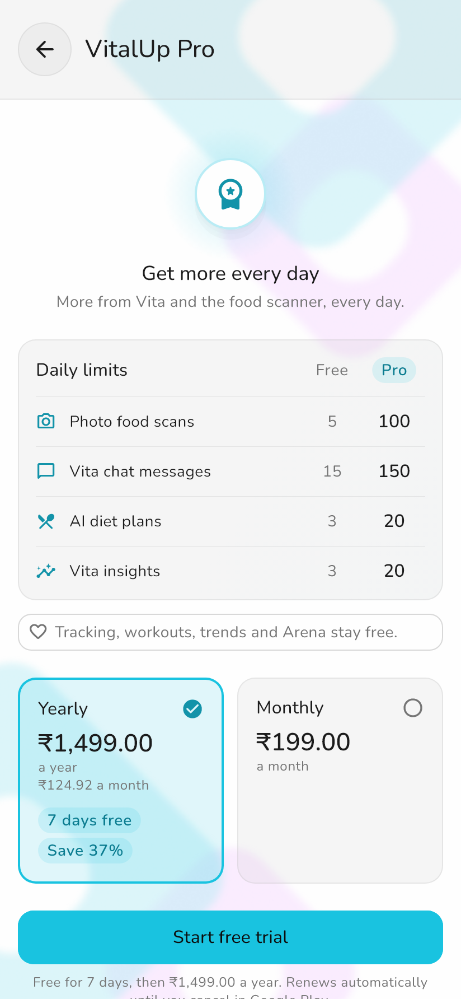</td>
  </tr>
  <tr>
    <td align="center"><sub><b>Onboarding</b><br/>Seven short steps, any of them skippable</sub></td>
    <td align="center"><sub><b>Starting goals</b><br/>Calculated from your answers</sub></td>
    <td align="center"><sub><b>VitalUp Pro</b><br/>Higher daily AI limits; tracking stays free</sub></td>
  </tr>
</table>

## Features

| Area | What it does |
| :--- | :--- |
| **Activity** | GPS workouts (walk, run, cycle, trek, climb) on Mapbox with offline map areas, a wall-clock workout timer for gym, yoga, HIIT and more, voice coach, music controls, BLE heart rate straps, daily and weekly activity goals. |
| **Nutrition** | AI photo scanner, barcode lookup (Open Food Facts fallback), label OCR, food search, custom foods, daily calorie and macro goals, AI diet plans with alternative dishes. |
| **Water, sleep, weight** | One-tap logging, goals that can be removed, sleep estimated from screen-off time and confirmed by the user, Health Connect import. |
| **Mood and stress** | Daily check-ins and a stress estimate from check-ins and lifestyle triggers. |
| **Screen time** | Daily usage and top apps from Android Usage Access, with an optional limit. |
| **Vita (AI coach)** | Chat, health analysis, stress guide and diet plan help, limited to health topics and the user's own data. Nothing is sent before the user consents. |
| **Arena** | Points, 20 levels, streaks with rest days, badges, friends, challenges, global / city / interest leaderboards and weekly and monthly awards. Scoring runs on the server. |
| **Reports** | Weekly summary push, a shareable health report (7, 30 or 90 days) and a full data export (CSV and JSON). |
| **Widgets and shortcuts** | Android home screen widgets (Today, custom metrics, water, mood check-in, shortcuts) and launcher shortcuts. |
| **Privacy and security** | Keystore-backed session, optional biometric app lock with secure screens, row level security on every table, analytics opt-out, in-app account deletion. |
| **Accessibility** | Honours the system text size up to 1.5x with layouts that reflow instead of cutting text, and contrast-checked colours in light and dark themes. |

## Architecture

Each feature lives in `lib/features/<feature>/` with `data`, `domain` and
`presentation` layers. State is managed with Cubits and Blocs, dependencies
are registered with `get_it`, and navigation uses `go_router`.

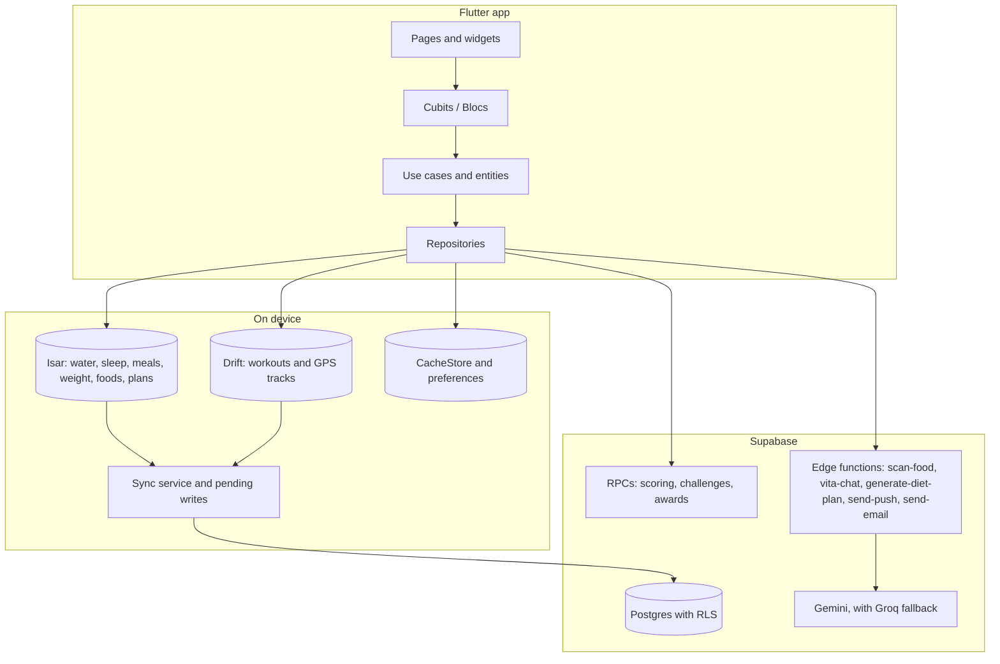

- **Offline first:** logs are written locally first. `SyncService` uploads them
  and pulls changes from other devices; writes made offline are queued and
  replayed in order. Cached server data is shown immediately and refreshed in
  the background.
- **Server-side trust:** points, streaks and badges are only ever changed
  through Postgres functions, never written directly by the client. Inputs are
  validated in the app and again in the database and edge functions.
- **AI with guard rails:** edge functions enforce daily quotas and per-minute
  limits, keep Vita on health topics and never write AI estimates into the
  shared food catalogue.

## Tech stack

| Layer | Technology |
| :--- | :--- |
| App | Flutter, Dart 3.12, `flutter_bloc`, `get_it`, `go_router`, `dartz` |
| Local data | Isar, Drift (SQLite), SharedPreferences, `flutter_secure_storage` |
| Backend | Supabase: Auth, Postgres with RLS, Storage, Realtime, pg_cron, Edge Functions (Deno) |
| AI | Google Gemini with Groq fallback, Google ML Kit (barcodes, text recognition) |
| Maps and sensors | Mapbox Maps SDK, `geolocator`, pedometer, `flutter_blue_plus` |
| Health | Health Connect (read only) via `health` |
| Platform | `home_widget`, `flutter_local_notifications`, `flutter_foreground_task`, `quick_actions`, `local_auth` |
| Monitoring | Firebase Cloud Messaging, Firebase Analytics, Crashlytics |
| Payments | RevenueCat over Google Play Billing |
| Releases | GitHub Actions, Shorebird code push, R8 and Dart obfuscation |

## Project structure

```
vital_up/
├── lib/
│   ├── core/          # theme, widgets, routing, DI, database, sync, utilities
│   └── features/      # one folder per feature: data / domain / presentation
├── android/           # native code: widgets, usage stats, UI sounds
├── supabase/
│   ├── migrations/    # schema, RLS policies, RPCs and cron jobs
│   └── functions/     # edge functions (AI, push, email, billing)
├── test/              # unit, widget, layout and flow tests (mirrors lib/)
├── website/           # vitalup.live landing page and legal pages
└── docs/              # release guide, notes and README screenshots
```

## Getting started

### Prerequisites

- Flutter (stable) with Dart 3.12 or newer
- Android Studio or the Android SDK, and a device or emulator
- A Supabase project, a Mapbox access token and a Google OAuth web client id

### Setup

```bash
git clone https://github.com/TarunTalan/vital_up.git
cd vital_up
flutter pub get

# Configuration is compiled in with envied
cp .env.example .env        # then fill in the values

# Generates Isar / Drift code and lib/core/config/env.g.dart
dart run build_runner build --delete-conflicting-outputs

flutter run
```

Run `build_runner` again after every change to `.env`: a normal build does not
regenerate the config, so the app would keep the old values.

| Variable | Purpose |
| :--- | :--- |
| `SUPABASE_URL`, `SUPABASE_PUBLISHABLE_KEY` | Supabase project |
| `MAPBOX_ACCESS_TOKEN` | Workout maps and offline areas |
| `GOOGLE_WEB_CLIENT_ID` | Google sign-in |
| `REVENUECAT_GOOGLE_API_KEY` | Optional; enables VitalUp Pro purchases |

### Backend

```bash
supabase db push                      # apply migrations
supabase functions deploy <name>      # deploy an edge function
```

Edge function secrets (AI provider keys, Resend, FCM, RevenueCat) are set with
`supabase secrets set`.

### Release build

```bash
flutter build appbundle --release --obfuscate --split-debug-info=build/symbols
```

See [`docs/PLAY_STORE_PRE_RELEASE_GUIDE.md`](docs/PLAY_STORE_PRE_RELEASE_GUIDE.md)
for signing, Play Console declarations and the tagged release workflow.

## Testing

```bash
flutter test                                  # whole suite
flutter test test/features/<feature>          # one feature
dart analyze lib test
```

The suite covers domain rules, repositories, sync against a fake Supabase
backend, Drift schema migrations and multi-device flows. Layout tests render
key screens on 360 to 800 dp screens at text sizes up to 1.5x, in light and
dark themes, and fail on any overflow or cut-off text.

### Regenerating screenshots

The images in [`docs/screenshots/`](docs/screenshots/) come from the widget
tests, so they always match the current UI. To refresh them:

```bash
README_SHOTS=1 flutter test --name readme \
  test/features/dashboard/home_cards_screenshot_test.dart \
  test/features/dashboard/tracker_detail_layout_test.dart \
  test/features/dashboard/log_sheets_screenshot_test.dart \
  test/features/food_scanner/meal_log_history_states_test.dart \
  test/features/vita/vita_pages_test.dart \
  test/features/community/arena_pages_layout_test.dart \
  test/features/onboarding/onboarding_flow_test.dart \
  test/features/subscription/subscription_test.dart
```

Shots are 412 x 892 dp at 2x. The shared helper is
[`test/helpers/readme_shots.dart`](test/helpers/readme_shots.dart).

## Links

- Website: [vitalup.live](https://vitalup.live)
- Privacy policy: [vitalup.live/privacy](https://vitalup.live/privacy)
- Terms of service: [vitalup.live/terms](https://vitalup.live/terms)
- Support: [support@vitalup.live](mailto:support@vitalup.live)
