<div align="center">

# 🌟 VitalUp - Smart Health & Wellness Companion

### *Build Sustainable Habits, Track Vital Metrics & Elevate Your Wellbeing with AI Coaching*

[](https://flutter.dev)
[](https://dart.dev)
[](https://supabase.com)
[](https://bloclibrary.dev)
[](https://isar.dev)
[](https://ai.google.dev)
[](https://android.com)

---

[📖 Overview](#-overview) • [📸 UI Showcase](#-app-screenshots--ui-showcase) • [✨ Core Features](#-core-features) • [🏗️ Architecture](#-system-architecture--flow-diagrams) • [🛠️ Tech Stack](#-tech-stack) • [📂 Project Structure](#-project-structure) • [🚀 Getting Started](#-getting-started) • [👥 Credits](#-credits)

---

</div>

## 📖 Overview

**VitalUp** is a next-generation holistic health, nutrition, and fitness ecosystem crafted with **Flutter** and **Clean Architecture**. It bridges real-time biometric tracking, smart hydration, sleep hygiene, and mental wellness with an **AI-powered food scanner**, an **automated diet plan generator**, and **Vita (Conversational AI Health Coach)**.

Built with an **offline-first hybrid architecture**, VitalUp guarantees seamless habit tracking via local caching (Isar) synchronized in real-time with **Supabase PostgreSQL**, secure encrypted storage, and high-performance serverless AI endpoints. VitalUp also features **interactive Android home screen widgets**, BLE sensor support for heart rate monitors, and an in-app motivational workout soundtrack system.

---

## 📸 App Screenshots & UI Showcase

Explore the design and feature depth of VitalUp across organized modules:

### 📊 1. Unified Dashboard & Quick Logging
| Daily Overview & Macros | Full Dashboard Scroll | Speed-Dial Quick Logger |
|:---:|:---:|:---:|
|  | 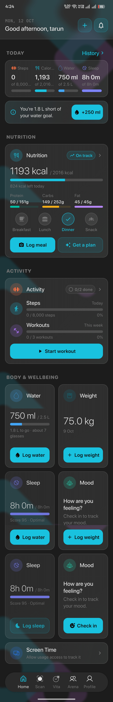 | 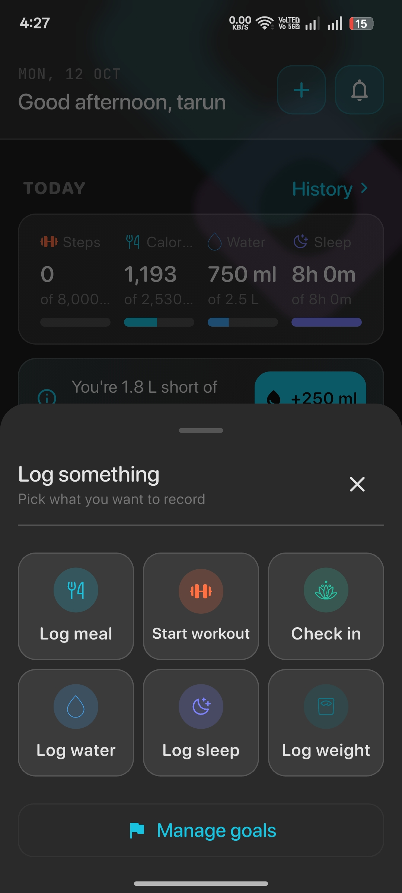 |
| *Today's rings, macro budget & status* | *Holistic scroll with all vitals & cards* | *1-tap logging for meals, water, sleep & mood* |

| Integrated Diet Plan Banner | Daily Meal Schedule |
|:---:|:---:|
| 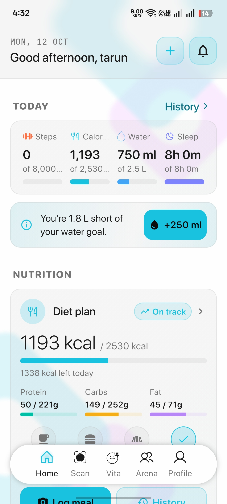 | 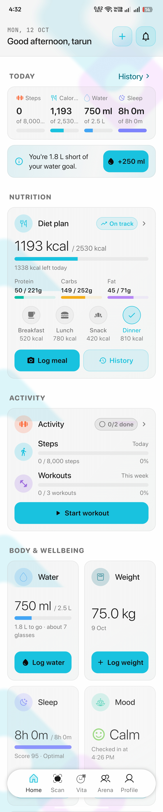 |
| *Active diet plan syncing directly with calories & macros* | *Itemized meal timeline: breakfast, lunch, snack & dinner* |

---

### 🥗 2. AI Food Scanner & Nutrition Intelligence
| Meal Scan & Nutritional Analysis |
|:---:|
|  |
| *Dual-engine vision detection, itemized dish breakdowns, USDA macros & personalized health recommendations* |

---

### 📋 3. Personalized Smart Diet Plan Engine
| Mode Selection | Target Weight & Timeline Setup | Generated Daily Meal Plan |
|:---:|:---:|:---:|
| 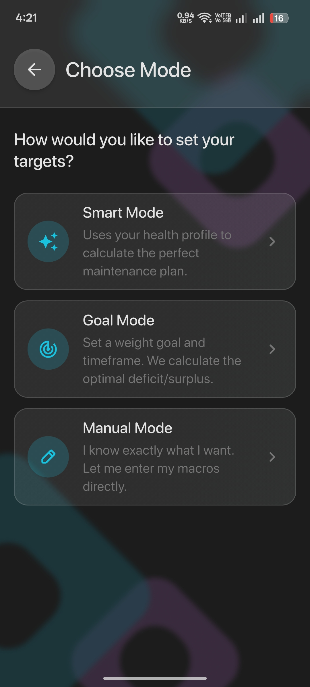 | 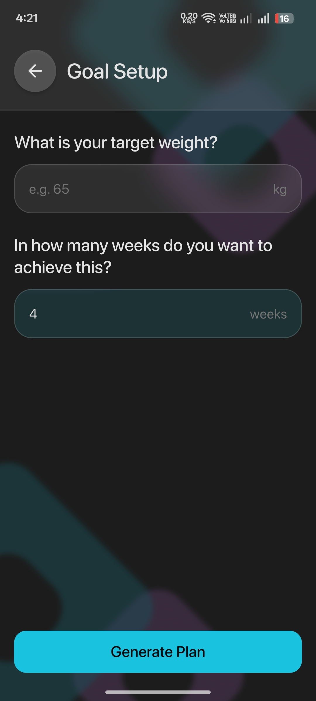 | 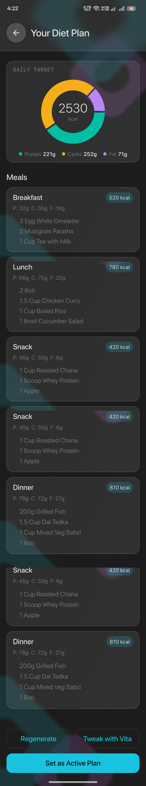 |
| *Smart Mode, Goal Mode & Manual Macro Mode* | *Target weight & target timeframe configuration* | *Gram-precise meals, macro splits & 1-tap plan activation* |

---

### 🤖 4. Vita — AI Health Companion & Holistic Analyzer
| Vita AI Companion Hub | Vita Conversational Health Chat | Multi-Signal Health Analysis |
|:---:|:---:|:---:|
| 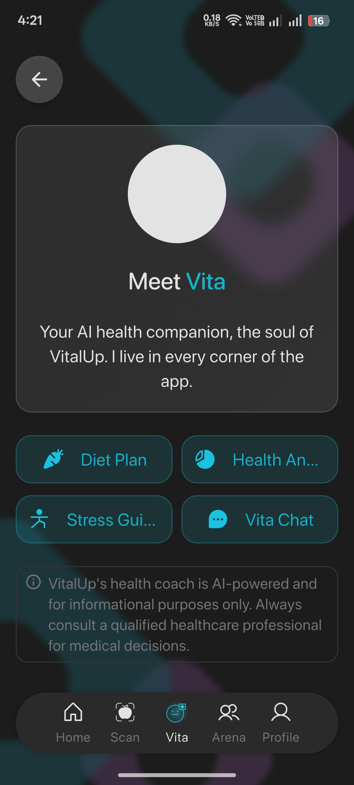 |  | 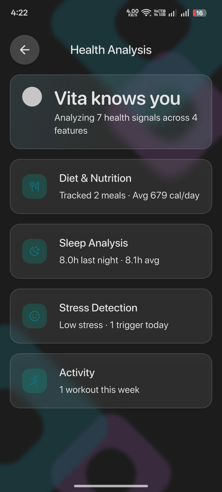 |
| *Central AI companion portal & quick guides* | *Contextual chat with instant health report synthesis* | *Holistic analysis across 7 signals and 4 wellness domains* |

---

### 🏃 5. Advanced Activity Tracking & Live Workout Companion
| Activity Consistency Calendar | Live Workout Tracker | Voice Coach & BLE Settings |
|:---:|:---:|:---:|
| 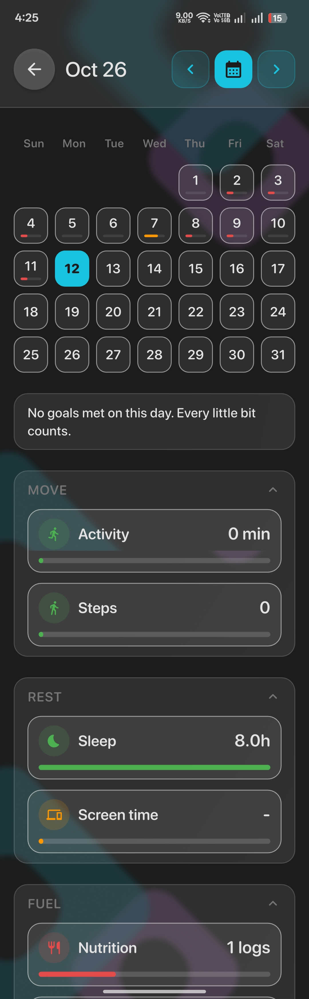 |  | 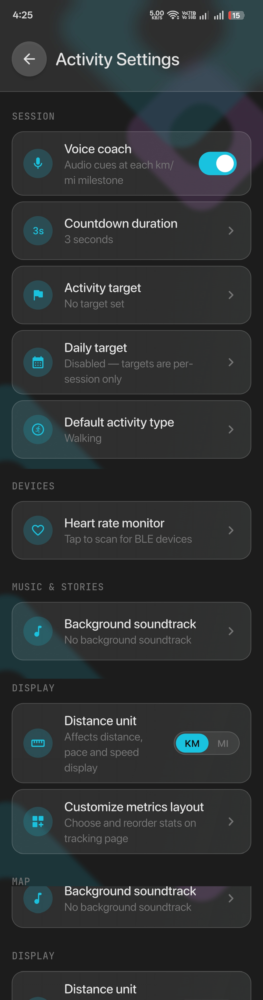 |
| *Move, Rest, Fuel breakdown across monthly calendar* | *Real-time GPS distance, duration, calories & pace* | *Milestone audio cues, countdowns & BLE heart rate* |

| Offline Maps & Custom Metrics | Workout History & Session Logs | Motivational Workout Soundtrack |
|:---:|:---:|:---:|
| 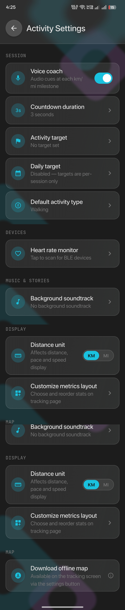 | 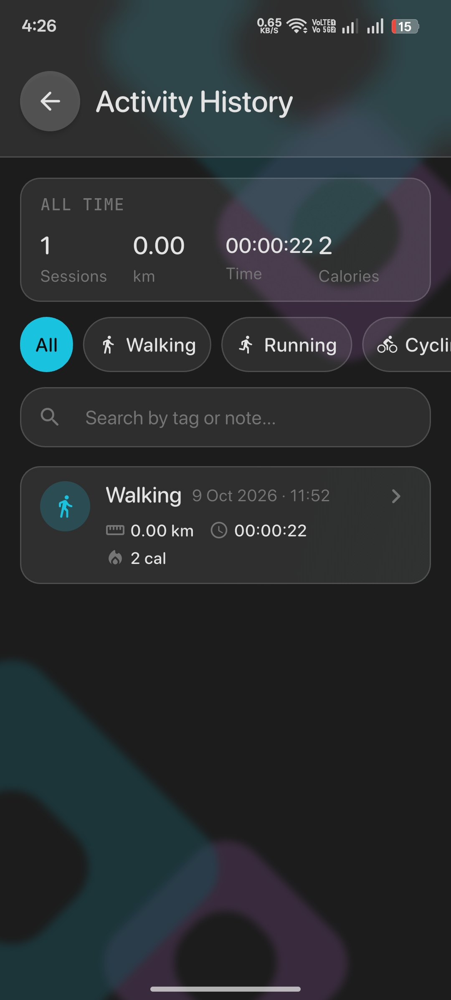 | 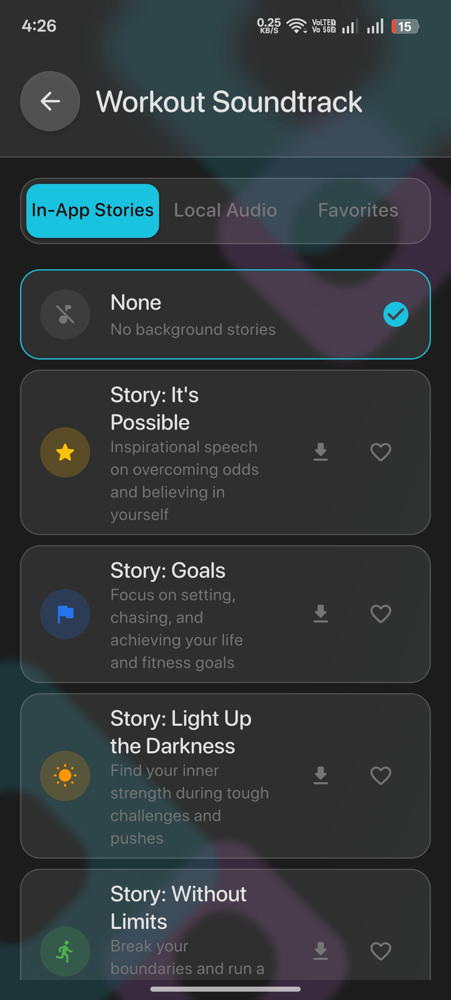 |
| *Customizable stats layout & offline map downloads* | *Historical sessions, filterable by walk, run or cycle* | *Curated motivational audio stories & local tracks* |

---

### 📈 6. Biometric Analytics & Mental Wellbeing Suite
| Daily Mood & Life Context Check-in | Fast Hydration Logger | Nutrition Trends & Macro Breakdown |
|:---:|:---:|:---:|
| 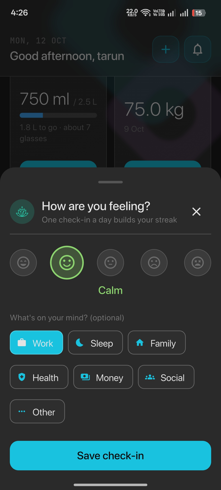 | 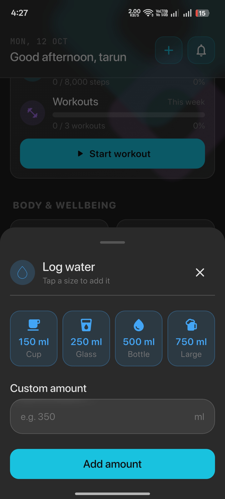 | 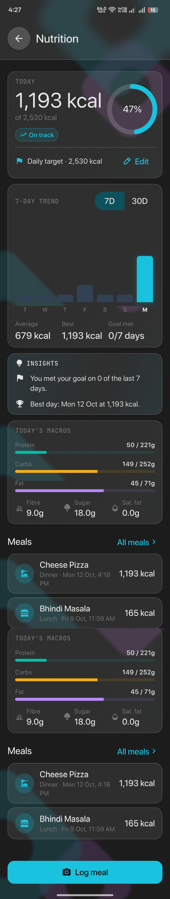 |
| *Track emotions & tag life triggers (Work, Sleep, Social)* | *Preset containers (150ml, 250ml, 500ml, 750ml, custom)* | *7-day trend chart, goal lines & micro/macro nutrients* |

| Sleep Quality Score & Hygiene | Mood & Stress Distribution |
|:---:|:---:|
| 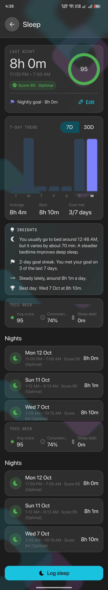 | 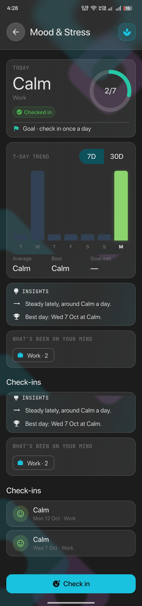 |
| *Optimal sleep score (0-100), consistency & sleep debt* | *Emotional stability charts & trigger correlation* |

---

### 🏆 7. Gamification Arena, Streaks & Social Challenges
| Arena Progress & Badges | Communities & Leaderboards | Points Economy & Rulebook |
|:---:|:---:|:---:|
| 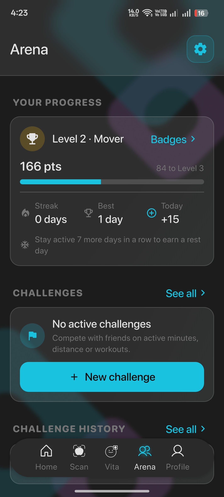 | 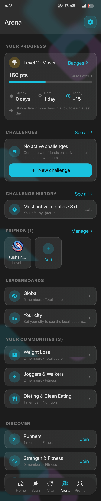 | 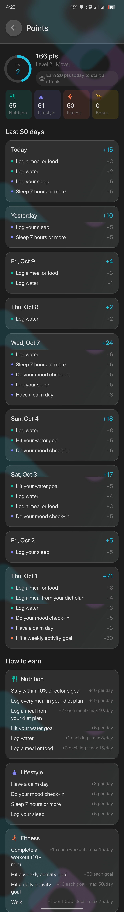 |
| *Level progression (Mover), streaks & rest day rewards* | *City/global rankings & specialized health communities* | *Points earned across Nutrition, Lifestyle & Fitness* |

| Create Head-to-Head Challenge | Friends Management & Invites | Community Group Leaderboard |
|:---:|:---:|:---:|
| 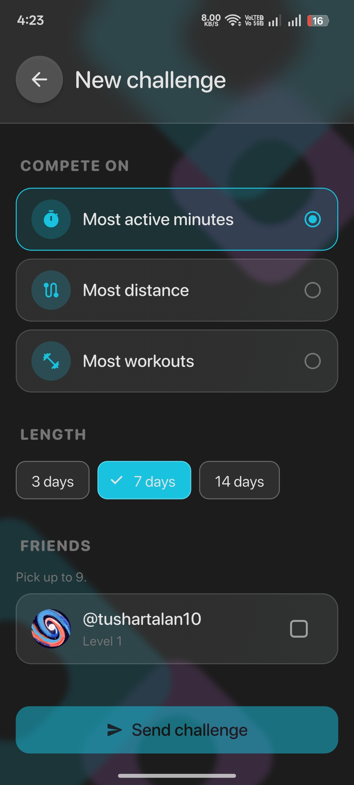 | 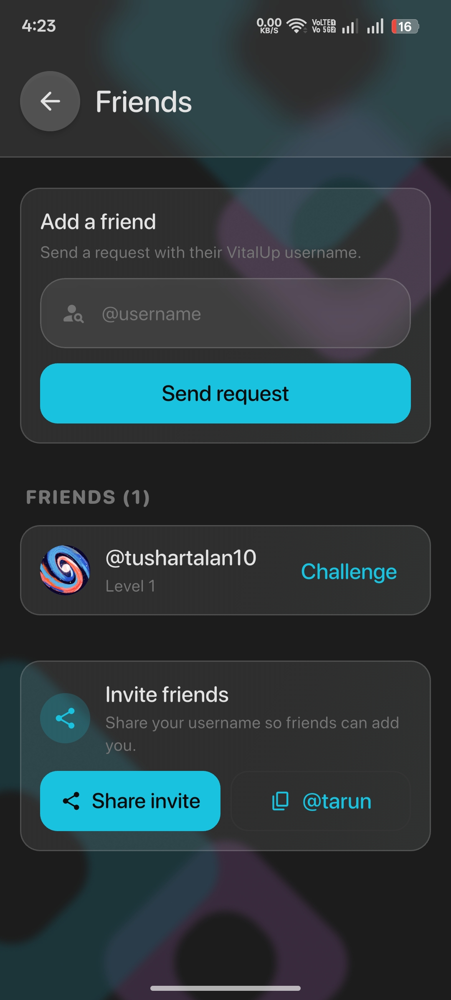 | 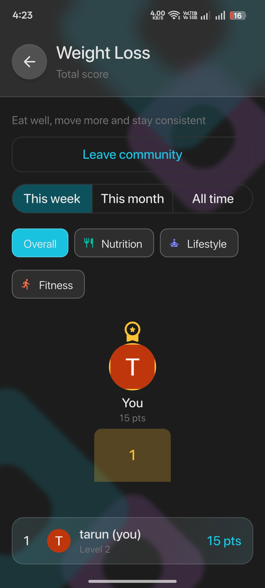 |
| *Compete on active minutes, distance or workouts (3-14d)* | *Add by username, send direct challenge & share code* | *Rankings filtered by week, month, all-time & domains* |

---

### 📱 8. Interactive Android Home Screen Widgets
| In-App Widget Gallery & Previews | Custom Metric Widget Builder | Android Launcher Showcase (Part 1) | Android Launcher Showcase (Part 2) |
|:---:|:---:|:---:|:---:|
| 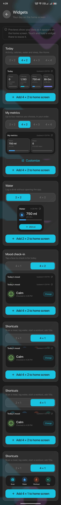 | 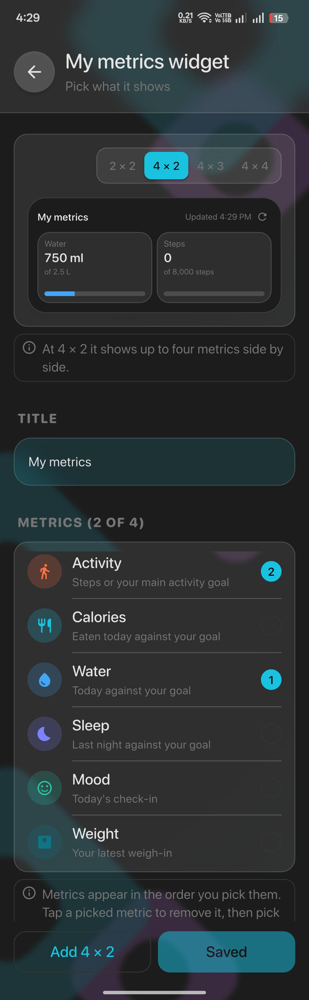 |  | 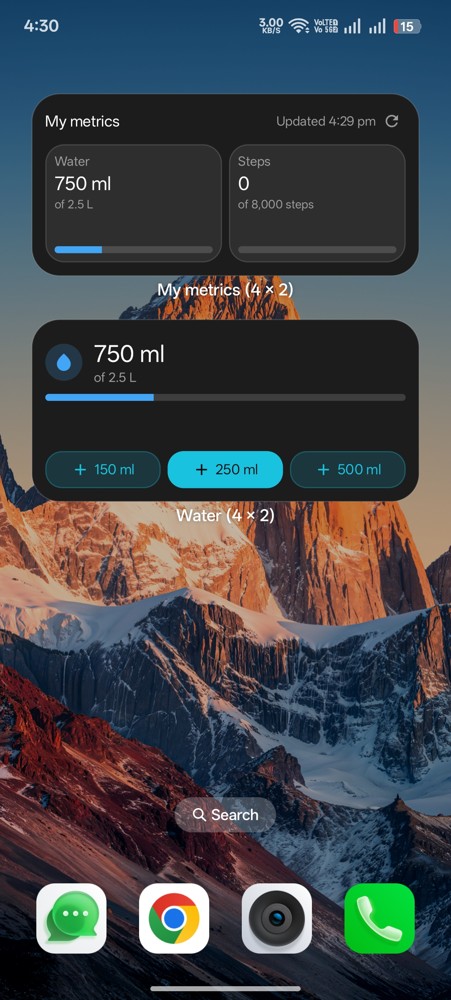 |
| *Interactive gallery for 4x2, 2x2 & 4x1 home widgets* | *Choose & reorder up to 4 personalized health vitals* | *Live Today Widget & Mood Check-in on launcher* | *My Metrics & 1-tap Water Log directly on launcher* |

---

### ⚙️ 9. Profile, Smart Settings & Habit Reminders
| Profile & Health Snapshot | App Settings & Privacy | Smart Habit Reminders |
|:---:|:---:|:---:|
| 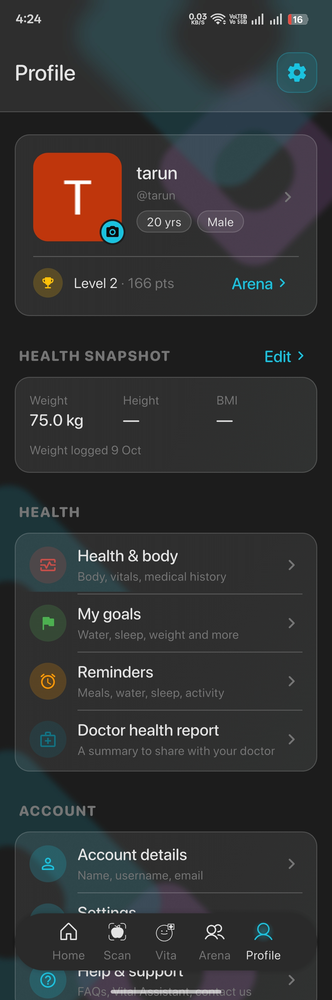 | 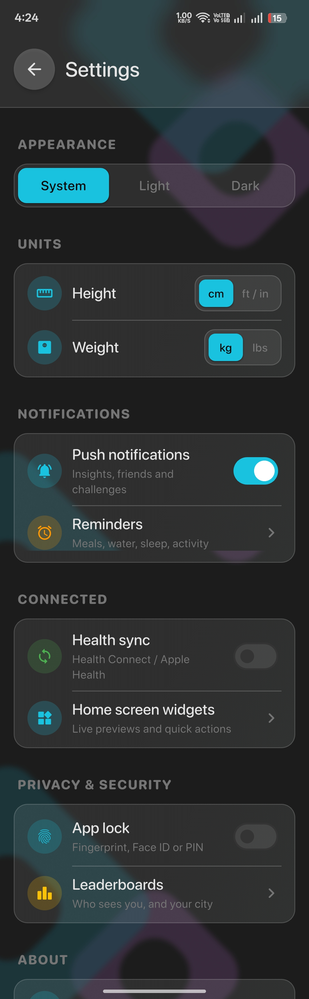 | 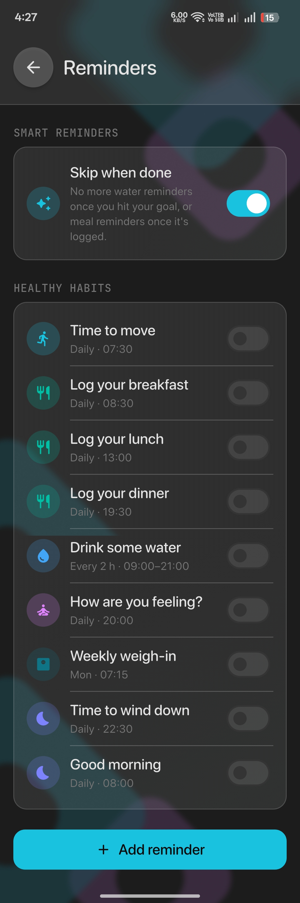 |
| *BMI, weight history & Doctor Health Report export* | *App lock (Fingerprint/PIN), Health Connect sync & theme* | *Auto-skip when done reminders for movement, hydration & meals* |

| Daily & Weekly Goal Configuration | Notifications & Weekly Reviews | Appearance & Measurement Units |
|:---:|:---:|:---:|
| 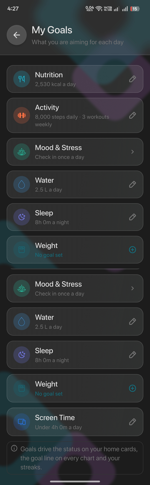 | 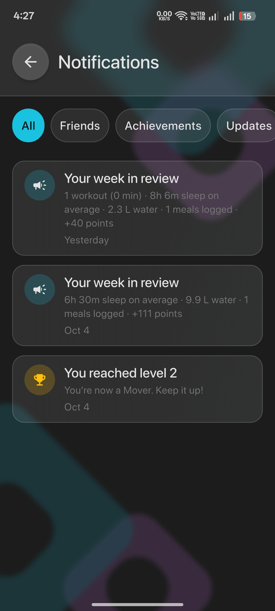 | 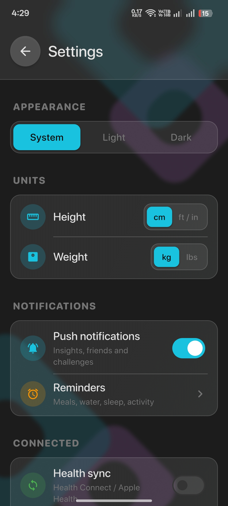 |
| *Customizable targets for nutrition, steps, sleep & screen time* | *Comprehensive notification center with points awards* | *System / Light / Dark modes + Metric / Imperial switching* |

---

## ✨ Core Features

### 📊 1. Unified Health Dashboard & Speed-Dial Logging
- **Real-Time Vitals Tracking:** Live progress rings and status cards for daily step count, active calories burned, hydration level, sleep duration, mood score, body weight, and screen time.
- **Speed-Dial Quick Logger:** Instant bottom sheet accessible anywhere to log meals, log water with custom container sizes, start a workout session, log sleep cycles, perform mood check-ins, record body weight, or tune goals.
- **Diet Plan Integration:** Dynamic syncing between active AI diet plans and home dashboard macros, displaying remaining caloric budget and macronutrient split (Protein, Carbs, Fats) in real time.

### 📸 2. AI-Powered Food & Nutrition Scanner
- **Dual-Model Vision Intelligence:** Primary visual recognition via **Google Gemini Flash Vision** with automated, zero-downtime failover to **Groq Vision (Llama-4 Vision)**.
- **Itemized Dish Recognition:** Accurately identifies individual dish components (e.g., Roti, Chana Masala, Curries, Rice, Salads) with gram-level portion estimates.
- **Comprehensive Nutritional Breakdown:** Delivers verified macro breakdowns (Carbs, Protein, Fat) along with micronutrients (Dietary Fiber, Total Sugars, Sodium) backed by **USDA FoodData Central** & **Open Food Facts**.
- **Nutritional Health Scoring & Alerts:** Computes an instant meal health score (0-100) and displays actionable clinical advice (e.g., high sodium warnings, fiber benefits).
- **Barcode Scanner:** High-speed packaged food barcode scanning using Google ML Kit.

### 🥗 3. Personalized Smart Diet Plan Engine
- **Three Versatile Planning Modes:**
  - **Smart Mode:** Calculates the optimal caloric maintenance plan using biometric data from the user profile.
  - **Goal Mode:** Calculates the exact caloric deficit or surplus needed based on target weight and chosen timeframe (in weeks).
  - **Manual Mode:** Full manual control for athletes and power users to set exact caloric and macronutrient targets.
- **Full-Day Meal Scheduling:** Generates structured meal recommendations (Breakfast, Lunch, Snacks, Dinner) with specific dish ideas, macro ratios, and calorie counts.
- **Interactive Plan Management:** One-tap action to **Set as Active Plan**, **Regenerate**, or **Tweak with Vita**.

### 🤖 4. Vita — AI Health Coach & Holistic Analyzer
- **Conversational Health Guidance:** Context-aware AI coach capable of answering health questions, recommending lifestyle adjustments, and formulating micro-habits based on user history.
- **Daily Health Report Synthesis:** Automatically summarizes daily calories, sleep duration, hydration volume, and estimated stress into a concise report.
- **Multi-Signal Holistic Analysis:** Continuously evaluates 7 health signals across 4 domains (Diet & Nutrition, Sleep Hygiene, Stress Triggers, and Physical Activity) to pinpoint wellness trends.

### 🏃 5. Advanced Activity Tracking & Live Workout Companion
- **Real-Time Workout Tracking:** Monitors distance (km/mi), duration, active calories, and average pace in real-time.
- **Voice Coach Audio Cues:** Text-to-speech audio coach announces pace, distance, and time at configurable kilometer/mile milestones.
- **BLE Heart Rate Monitor:** Bluetooth Low Energy connectivity to pair with external heart rate monitors and chest straps.
- **Workout Soundtrack & Motivational Stories:** Background audio playback engine featuring inspirational stories (*It's Possible*, *Goals*, *Light Up the Darkness*, *Without Limits*) and local audio support.
- **Offline Maps & Metrics Customization:** Cache maps for off-grid runs and freely customize and reorder tracking metrics on screen.
- **Workout History & Consistency Calendar:** Searchable history filterable by Walking, Running, or Cycling, complemented by a monthly "Move, Rest, Fuel" habit calendar.

### 📈 6. Biometric Analytics & Wellbeing Suite
- **In-Depth Nutrition Analytics:** 7-day caloric trend charts, macro distributions, insight banners, and timestamped meal logs.
- **Sleep Quality & Hygiene Score:** Sleep duration, bed/wake times, 0-100 optimal sleep score, bedtime consistency variance, and sleep debt tracking.
- **Mood & Stress Management:** Daily emotional check-in with life contextual tags (Work, Health, Sleep, Money, Family, Social) and 7-day stress distribution charts.
- **Hydration Tracker:** Visual water level tracker with one-tap logging for cups (150ml), glasses (250ml), bottles (500ml), large containers (750ml), or custom milliliter inputs.

### 🏆 7. Gamification Arena, Streaks & Social Challenges
- **Dynamic Progression & Streaks:** Level up through tiers (e.g., Level 2 Mover), earn badges, and unlock rest day rewards after consistent activity streaks.
- **Transparent Points Economy:** Granular point allocations rewarding nutrition consistency (+10-15 pts), hydration (+5 pts), calm days (+5 pts), sleep hygiene (+5 pts), and workouts (+15 pts).
- **Social Head-to-Head Challenges:** Create 3, 7, or 14-day competitions against friends on active minutes, total distance, or workout counts.
- **Community Interest Hubs & Leaderboards:** Join specialized communities (Weight Loss, Joggers & Walkers, Clean Eating) and compete on weekly, monthly, and all-time leaderboards.

### 📱 8. Interactive Android Home Screen Widgets
- **Today Overview Widget (4x2):** Glanceable steps, calories, water, and sleep rings with 1-tap launcher shortcuts (Scan, Water, Workout, Vita).
- **My Metrics Customizable Widget (4x2):** Customizable widget allowing users to select and reorder up to 4 personalized metrics (Activity, Calories, Water, Sleep, Mood, Weight).
- **1-Tap Hydration Widget (2x2):** Quick-log +150ml, +250ml, or +500ml of water directly from the phone's home launcher without opening the app.
- **Mood Check-in Widget (4x2 / 2x1):** Immediate emotional status check-in right from the home screen.
- **In-App Widget Gallery:** Visual previewer to inspect and configure widget layouts prior to pinning.

### ⚙️ 9. Profile, Goals, Security & Smart Reminders
- **Health Snapshot & Doctor Report:** Personal profile showcasing BMI, weight logs, and a downloadable clinical summary to share with physicians.
- **Smart Habit Reminders:** Context-sensitive reminder engine with "Skip when done" intelligence — automatically suppresses hydration or meal notifications once logged.
- **Privacy & Biometric App Lock:** Safeguards health data using Fingerprint, Face ID, or PIN authentication, with granular leaderboard privacy controls.
- **Customizable Appearance & Units:** Seamless switching between System, Light, and Dark themes, with full Metric (kg, cm, ml) and Imperial (lbs, in, fl oz) conversion support.

---

## 🏗️ System Architecture & Flow Diagrams

VitalUp adheres strictly to **Clean Architecture** principles separated into **Domain**, **Data**, and **Presentation** layers with the **BLoC/Cubit** state management pattern.

### 1. High-Level Architectural Layers

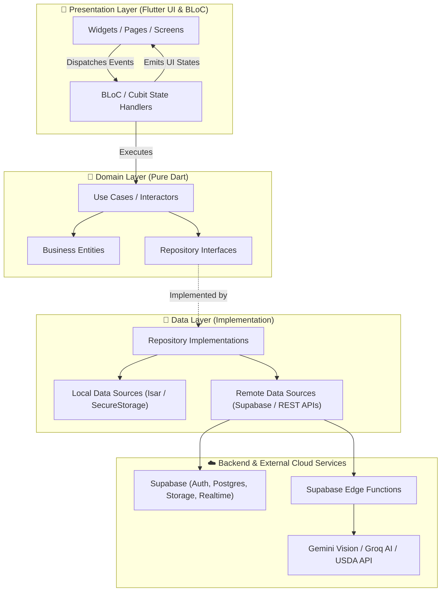

---

### 2. User Journey & Core Application Loop

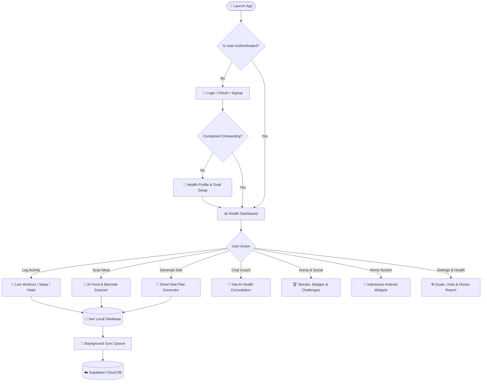

---

### 3. AI Food Scanner & Nutrition Pipeline

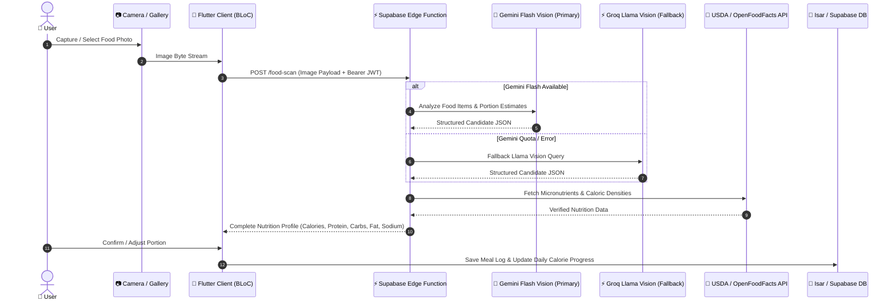

---

### 4. Hybrid Offline-First Sync Architecture

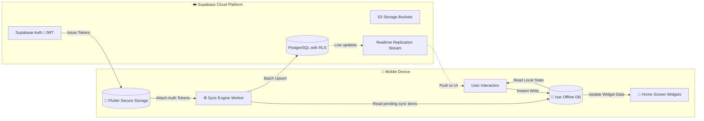

---

## 🛠️ Tech Stack

### **Frontend & Mobile Framework**
- **Core Framework:** [Flutter](https://flutter.dev) (v3.x / Dart 3.x)
- **Architecture Pattern:** Clean Architecture (Domain, Data, Presentation)
- **State Management:** `flutter_bloc` / `bloc` / `cubit`
- **Dependency Injection:** `get_it` + `injectable`
- **Navigation & Routing:** `go_router`
- **Network Client:** `dio` with automated interceptors, JWT refresh & retry policies
- **Device Utilities:** `permission_handler`, `connectivity_plus`, `device_preview`

### **Sensors, Hardware & Background Services**
- **Home Screen Widgets:** `home_widget` (Android interactive widgets)
- **Voice Coaching (TTS):** `flutter_tts`
- **Heart Rate Monitor:** `flutter_blue_plus` (Bluetooth Low Energy / BLE)
- **Audio Engine & Background Soundtrack:** `just_audio`, `just_audio_background`, `audio_session`
- **Barcode & Vision Hardware:** `camera`, `google_mlkit_barcode_scanning`, `google_mlkit_text_recognition`, `image_picker`
- **Local Biometrics:** `local_auth` (Fingerprint, Face ID, PIN)
- **Push & Local Notifications:** `firebase_messaging`, `flutter_local_notifications`, `timezone`

### **Data & Storage**
- **Local Database (Offline-First):** `isar` / `isar_flutter_libs`
- **Secure Key-Value Storage:** `flutter_secure_storage`
- **Cloud Database:** [Supabase](https://supabase.com) (PostgreSQL 15+ with Row Level Security)
- **Cloud Storage:** Supabase Storage (Buckets: `profile-pictures`, `medical-reports`, `food-images`)

### **AI & Vision Microservices**
- **Primary Vision Engine:** Google Gemini Flash Vision API
- **Fallback Vision Engine:** Groq Llama-4 Vision API (Zero-downtime failover)
- **Nutrition Knowledge Base:** USDA FoodData Central & Open Food Facts API
- **Serverless Compute:** Supabase Edge Functions (Deno Runtime)

---

## 📂 Project Structure

```
vital_up/
├── assets/
│   ├── audio/              # Motivational stories & workout soundtracks
│   ├── data/               # Static food datasets & challenge templates
│   ├── fonts/              # Custom brand typography
│   ├── icons/              # Scalable vector graphics (SVG)
│   ├── images/             # Onboarding illustrations & banners
│   └── screenshots/        # Organized UI screenshots by feature
│       ├── activity_tracking/    # Live workout, voice coach, history, maps, audio
│       ├── community_challenges/ # Friend challenges, invites & community leaderboards
│       ├── dashboard/            # Home overview, full scroll, quick dial, diet sync
│       ├── diet_plan/            # Mode selection, goal setup & generated meals
│       ├── food_scanner/         # AI meal detection & nutritional breakdown
│       ├── gamification_arena/   # Arena progress, badges, leaderboards & points rules
│       ├── health_analytics/     # Macros, sleep hygiene, mood/stress & hydration
│       ├── home_widgets/         # Widget gallery, metric customizer & Android launcher
│       ├── profile_settings/     # Profile snapshot, settings, smart reminders, goals
│       └── vita_ai/              # Vita hub, health consultation chat & holistic analysis
├── lib/
│   ├── core/
│   │   ├── config/         # Supabase configs, API endpoints & keys
│   │   ├── database/       # Isar database schemas & sync managers
│   │   ├── di/             # GetIt service locator registrations
│   │   ├── error/          # Failures, exceptions & error handling
│   │   ├── network/        # Dio client, interceptors & auth refreshers
│   │   ├── router/         # GoRouter navigation paths & route guards
│   │   ├── theme/          # AppTheme, typography, colors & dimension tokens
│   │   └── widgets/        # Shared buttons, inputs, cards & dialogs
│   ├── features/
│   │   ├── activity_tracking/ # GPS tracking, voice coach, BLE heart rate & history
│   │   ├── auth/           # OAuth, login, signup, OTP & session recovery
│   │   ├── challenges/     # Head-to-head friend challenges & streak competitions
│   │   ├── community/      # Specialized groups & social leaderboards
│   │   ├── dashboard/      # Daily vitals hub, progress rings & quick logger
│   │   ├── diet_plan/      # Smart, Goal & Manual diet plan generator
│   │   ├── food_scanner/   # AI camera scanner, barcode scanner & USDA nutrition
│   │   ├── gamification/   # Arena levels, badges, points rulebook & streaks
│   │   ├── health_report/  # Doctor health report generation & export
│   │   ├── home_widget/    # Android home screen widgets & sync services
│   │   ├── notifications/  # FCM push alerts, local notifications & weekly reviews
│   │   ├── onboarding/     # Goal selection, personal biometric input & permissions
│   │   ├── profile/        # Avatar management, unit settings & medical records
│   │   ├── reminders/      # Smart habit reminders with auto-skip intelligence
│   │   ├── settings/       # App lock, appearance, units & privacy controls
│   │   └── vita/           # Vita AI Health Coach conversation & health analysis
│   └── main.dart           # Application entry point & service initialization
├── supabase/
│   ├── functions/          # Deno-based Edge Functions (food-scan proxy, vita AI)
│   └── migrations/         # PostgreSQL DDL, tables, triggers & RLS policies
└── pubspec.yaml            # Dependencies, assets & fonts configuration
```

---

## 🚀 Getting Started

### Prerequisites
- [Flutter SDK](https://docs.flutter.dev/get-started/install) (`>= 3.2.0`)
- [Dart SDK](https://dart.dev/get-dart) (`>= 3.2.0`)
- Android Studio / VS Code with Flutter & Dart extensions
- Android device or emulator with API Level 26+ (for home screen widgets and BLE features)
- A [Supabase](https://supabase.com) project account

---

### Installation Steps

1. **Clone the Repository:**
   ```bash
   git clone https://github.com/TarunTalan/vital_up.git
   cd vital_up
   ```

2. **Install Dependencies:**
   ```bash
   flutter pub get
   ```

3. **Generate Code (Isar schemas & injectable):**
   ```bash
   dart run build_runner build --delete-conflicting-outputs
   ```

4. **Configure Environment Variables:**
   Create or update your Supabase configuration in `lib/core/config/supabase_config.dart` or `.env`:
   ```dart
   class SupabaseConfig {
     static const String supabaseUrl = 'https://YOUR_PROJECT_ID.supabase.co';
     static const String supabaseAnonKey = 'YOUR_ANON_PUBLIC_KEY';
   }
   ```

5. **Run on Device or Emulator:**
   ```bash
   # Run in Debug mode
   flutter run

   # Or run specific target
   flutter run -d android
   ```

---

## 🗄️ Database & Supabase Setup

VitalUp utilizes PostgreSQL with **Row Level Security (RLS)** to safeguard personal health records and biometric data.

### Storage Buckets Setup
Ensure the following Supabase storage buckets are configured with appropriate access policies:
- `profile-pictures` *(Public read, authenticated write)*
- `food-images` *(Authenticated upload & read)*
- `medical-reports` *(Private, signed URL access only)*

### Database Tables Overview
- `profiles` — User demographics, metric units, avatar URLs, and health preferences.
- `step_logs` — Timestamped step increments, active minutes, and estimated distance.
- `water_logs` — Daily hydration entries and goal milestones.
- `sleep_logs` — Sleep duration, deep/light cycles, and wake times.
- `food_logs` — Logged meals, macro breakdowns, and scanned food images.
- `diet_plans` — AI-generated meal plans, daily caloric targets, and macro split recipes.
- `streaks` — Active streaks, highest streaks, and streak freeze protections.
- `challenges` — Community challenge participation, friend invites, and leaderboard scores.

---

## 👥 Credits

- **UI/UX Design:** Vedanshi
- **Frontend & Architecture:** Tarun & Siddhi
- **Backend (Spring Boot / Supabase):** Monu Chaudhary & Somil Jain

---

## 📄 License

This project is licensed under the **MIT License** — see the [LICENSE](LICENSE) file for details.

<div align="center">
  <sub>Built with ❤️ by the VitalUp Team</sub>
</div>