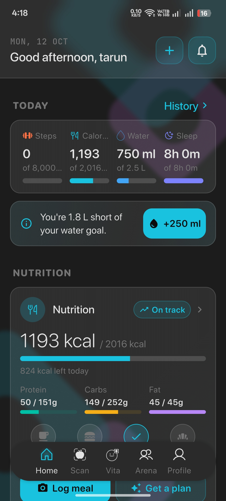
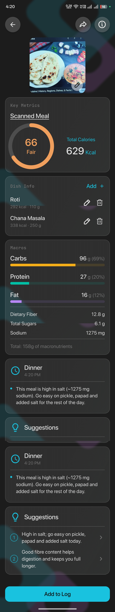
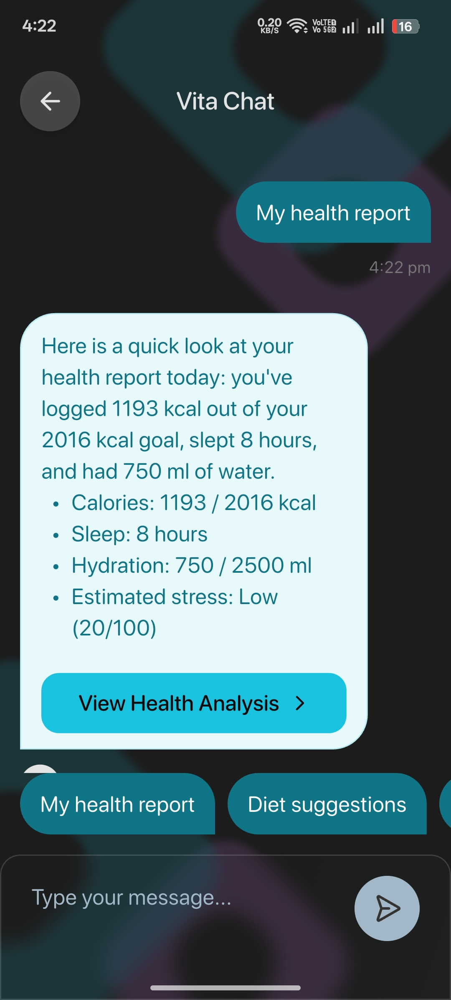
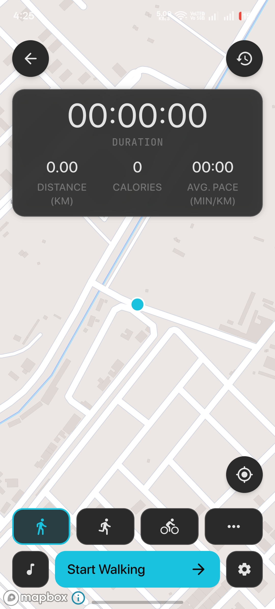
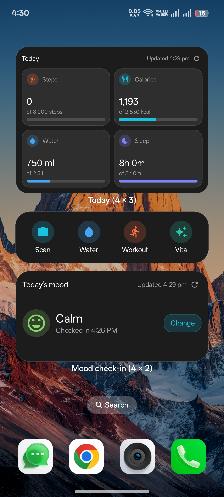
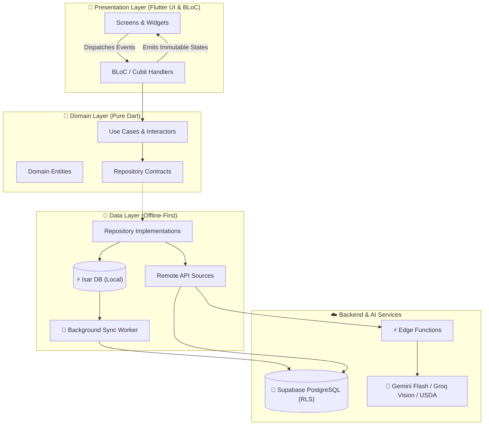

<div align="center">

# 🌟 VitalUp

### *Production-Grade Holistic Health & Fitness Platform*

*Engineered with Flutter, Clean Architecture, Offline-First Synchronization, Multi-LLM Vision Fallback, and Native Android Home Screen Widgets.*

[](https://flutter.dev)
[](https://dart.dev)
[](https://bloclibrary.dev)
[](https://isar.dev)
[](https://supabase.com)
[](https://ai.google.dev)
[](https://android.com)
[](LICENSE)

---

[UI Showcase](#-flagship-ui-showcase) • [Core Engineering Highlights](#-core-engineering-highlights) • [System Architecture](#-system-architecture) • [Tech Stack](#-tech-stack-summary) • [Quick Start](#-quick-start) • [Team](#-engineering-team)

---

</div>

## 📌 Executive Summary

**VitalUp** is a full-featured cross-platform mobile health ecosystem built for high performance, reliability, and offline autonomy. It unifies daily biometric tracking (steps, hydration, sleep hygiene, and stress) with an **AI food vision pipeline**, an **automated macronutrient diet planner**, and **Vita (Conversational AI Health Coach)**.

Engineered with **Clean Architecture** and **BLoC pattern**, VitalUp features an **offline-first local database (Isar)** that seamlessly reconciles with **Supabase PostgreSQL**, background BLE sensor connectivity, Text-to-Speech coaching, and interactive Android home screen widgets.

---

## 📱 Flagship UI Showcase

<div align="center">

### 🌓 Dual-Theme Support & Daily Hub
| 🌙 Dark Mode Dashboard | ☀️ Light Mode Dashboard | 📸 AI Food Vision Scanner |
|:---:|:---:|:---:|
|  |  |  |
| *Unified rings, macro budget & vitals* | *Full light theme with responsive styling* | *Instant meal detection & USDA macros* |

### 🤖 Intelligent Features & Native Android Integration
| 🤖 Vita AI Health Coach | 🏃 Live Workout Tracker | 📱 Interactive Android Widgets |
|:---:|:---:|:---:|
|  |  |  |
| *Context-aware consultation & reports* | *Real-time GPS, pace, duration & audio cues* | *Live vitals & 1-tap quick logging on launcher* |

</div>

> 📂 **Complete Gallery:** All 40+ high-resolution app screenshots are cataloged by feature in [`assets/screenshots/`](assets/screenshots/) (`activity_tracking`, `dashboard`, `diet_plan`, `food_scanner`, `gamification_arena`, `health_analytics`, `home_widgets`, `profile_settings`, `vita_ai`).

---

## 🚀 Core Engineering Highlights

### 1. 📸 Resilient Dual-Model AI Vision Pipeline
- **Zero-Downtime Failover:** Primary food image recognition driven by **Google Gemini Flash Vision**, with automatic fallback to **Groq Llama-4 Vision** if rate limits or network issues arise.
- **Accurate Macronutrient Profiling:** Deconstructs multi-item meals into discrete dishes, calculates calories/protein/carbs/fats/sodium, and syncs with **USDA FoodData Central** and **Open Food Facts**.

### 2. ⚡ Offline-First Architecture & Sync Engine
- **Local Persistence with Isar:** Sub-millisecond reads and writes on-device ensure full application functionality without internet connectivity.
- **Background Sync Queue:** Automatically reconciles local mutation queues with **Supabase PostgreSQL** via Row Level Security (RLS) when connectivity resumes.

### 3. 🤖 Vita: Conversational AI Health Engine
- **Context-Aware Wellness Coach:** Evaluates historical trends to provide actionable lifestyle guidance and generate instantaneous daily health status reports.
- **Multi-Signal Holistic Diagnostics:** Correlates 7 health signals across 4 dimensions (Diet, Sleep, Stress Triggers, and Physical Activity).

### 4. 🏃 Real-Time Workout Engine & Hardware Integration
- **Sensor & Audio Suite:** Combines real-time GPS tracking with milestone Text-to-Speech (**TTS**) audio cues, background motivational soundtracks (`just_audio`), and Bluetooth Low Energy (**BLE**) heart rate monitor pairing.
- **Offline Maps & Customization:** Downloadable map tiles for trail tracking and reconfigurable metric layouts.

### 5. 📱 Native Android Home Screen Widgets
- **Interactive Launcher Experience:** Built with `home_widget` to provide a 4x2 Today Vitals dashboard, customizable 4x2 metrics builder, and 1-tap hydration quick-logging directly from the home screen.

### 6. 🔒 Clinical Reports, Gamification & Security
- **Doctor Health Reports:** Exportable clinician-ready summaries detailing cardiovascular vitals, sleep quality, and activity trends.
- **Biometric Security:** Biometric app lock (Fingerprint, Face ID, PIN) powered by `local_auth`.
- **Habit Gamification:** Level progression (e.g., Level 2 Mover), rest day incentives, multi-category points economy, and peer challenges (3/7/14 days).

---

## 🏗️ System Architecture



---

## 🛠️ Tech Stack Summary

| Domain | Technologies & Packages |
| :--- | :--- |
| **Framework & Language** | Flutter 3.x, Dart 3.x |
| **Architecture** | Clean Architecture (Domain, Data, Presentation) |
| **State Management** | `flutter_bloc`, `bloc`, `cubit` |
| **Dependency Injection** | `get_it`, `injectable` |
| **Local Offline Database** | `isar`, `isar_flutter_libs`, `flutter_secure_storage` |
| **Backend & Cloud** | Supabase (PostgreSQL 15+, Auth, Storage, Edge Functions, Realtime) |
| **AI & Computer Vision** | Google Gemini Flash Vision API, Groq Vision API, USDA FoodData Central |
| **Device & Native Extras** | `home_widget` (Android widgets), `flutter_blue_plus` (BLE HR monitors) |
| **Audio & Voice** | `flutter_tts` (Voice Coach), `just_audio`, `just_audio_background` |
| **Security & Privacy** | `local_auth` (Biometrics / PIN), Row Level Security (RLS) |

---

## 📂 Project Structure

```
vital_up/
├── assets/
│   ├── audio/              # Motivational stories & workout soundtracks
│   ├── data/               # Static nutritional & challenge datasets
│   └── screenshots/        # Categorized screenshots by feature module
│       ├── activity_tracking/    # Live workout, voice coach, BLE settings, maps
│       ├── community_challenges/ # Peer challenges, invites & group leaderboards
│       ├── dashboard/            # Dark & Light mode dashboards, quick actions
│       ├── diet_plan/            # Mode selection, goal setup & generated meals
│       ├── food_scanner/         # AI meal detection & nutritional breakdown
│       ├── gamification_arena/   # Arena tiers, points rules & badge systems
│       ├── health_analytics/     # Macro trends, sleep score, mood & stress
│       ├── home_widgets/         # Interactive Android widgets & launcher showcase
│       ├── profile_settings/     # Settings, smart reminders & doctor health reports
│       └── vita_ai/              # Vita AI health coach & holistic health diagnostics
├── lib/
│   ├── core/               # Theme, DI, network interceptors, routes & base widgets
│   └── features/           # Modular feature packages (data, domain, presentation)
│       ├── activity_tracking/ # GPS tracking, voice cues & BLE monitors
│       ├── dashboard/         # Unified vitals hub & speed-dial logger
│       ├── diet_plan/         # Smart, Goal & Manual meal generator
│       ├── food_scanner/      # AI camera scanner & USDA nutrition
│       ├── gamification/      # Points economy, badges & streaks
│       ├── home_widget/       # Android launcher widgets
│       ├── vita/              # Vita AI chat & holistic diagnostics
│       └── ...
└── pubspec.yaml            # Dependencies & assets configuration
```

---

## 🚀 Quick Start

### 1. Clone & Install
```bash
git clone https://github.com/TarunTalan/vital_up.git
cd vital_up
flutter pub get
```

### 2. Generate Code (Isar & Dependency Injection)
```bash
dart run build_runner build --delete-conflicting-outputs
```

### 3. Configure Supabase Credentials
Add your Supabase endpoint and public key in `lib/core/config/supabase_config.dart`:
```dart
class SupabaseConfig {
  static const String supabaseUrl = 'https://YOUR_PROJECT_ID.supabase.co';
  static const String supabaseAnonKey = 'YOUR_ANON_PUBLIC_KEY';
}
```

### 4. Run the App
```bash
# Debug mode
flutter run

# Target specific Android device
flutter run -d android
```

---

## 📄 License

This project is licensed under the [MIT License](LICENSE).

<div align="center">
  <sub>Built with ❤️ by the VitalUp Team</sub>
</div>